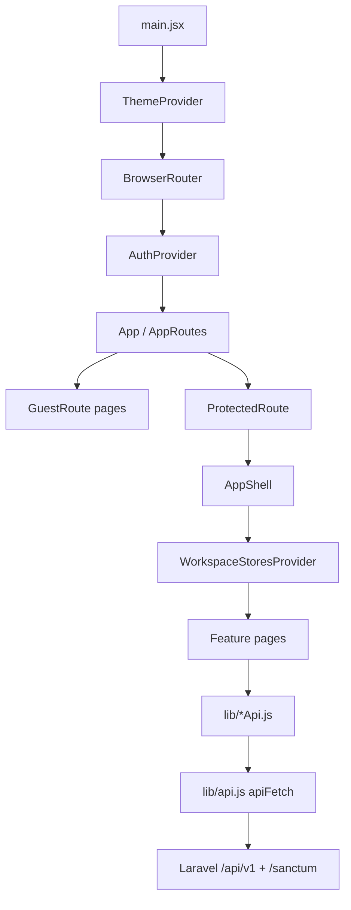

# Frontend architecture

Companion to the [README](../README.md).

## React application structure



Key paths:

| Concern | Path |
|---------|------|
| Entry | `src/main.jsx` |
| Routes | `src/routes.jsx` |
| Shell / nav | `src/components/layout/*`, `src/navigation/navConfig.js` |
| Auth | `src/auth/*` |
| Active store | `src/store/WorkspaceStoresProvider.jsx`, `useActiveStore.js` |
| HTTP | `src/lib/api.js` |
| Domain APIs | `src/lib/contactsApi.js`, `tagsApi.js`, `segmentsApi.js`, `importsApi.js`, `storesApi.js`, `shopifyOAuth.js` |
| UI kit | `src/components/ui/*` |
| Theme | `src/theme/*` |
| Mocks | `src/mock/*` |

## Entry point and routing

`AppRoutes` uses `useRoutes` from react-router-dom 7:

- **Guest:** `/login`, `/register`
- **Protected children of `/`:** dashboard, campaigns*, automation*, forms*, audience/*, insights*, resources*, settings/*
- Unknown paths → redirect `/`

\* Many of these pages render mock data only — see [ROADMAP-AND-GAPS.md](ROADMAP-AND-GAPS.md).

## Providers and authentication

1. `AuthProvider` holds `status` (`loading` | `authenticated` | `unauthenticated`) and `user`.
2. On mount: `GET /api/v1/auth/me`. HTTP 401 → guest.
3. `login` / `register` / `logout` call `authApi.js`.
4. `ProtectedRoute` redirects to `/login` (preserves `from`). `GuestRoute` sends authenticated users home.

Helpers: `authGate.js`, `backendStore.js` (`getPrimaryWorkspace`).

## Workspace / store context

`WorkspaceStoresProvider` (inside `AppShell` only):

- Resolves workspace = `user.workspaces[0]` (no multi-workspace switcher UI)
- Loads `GET /api/v1/workspaces/{id}/stores`
- Filters `is_demo` stores out of the switcher
- `selectStore` / `createStore` call activate + refresh user/stores

## API client and services

`apiFetch` (`src/lib/api.js`):

1. Always `ensureCsrfCookie()` first
2. Sends `Accept: application/json`, `X-Requested-With`, `X-XSRF-TOKEN`, `credentials: 'include'`
3. Maps failures through `toApiError` / `ApiError`

Vite proxy (`vite.config.js`) forwards `/api` and `/sanctum` to `127.0.0.1:8000` and rewrites Origin/Referer for Sanctum stateful checks.

Audience helpers share pagination parsing via `audienceApi.js`.

## State management

- React Context for auth, active store, theme
- Page-local `useState` / `useEffect` for lists and forms
- No global server cache; imports keep history in `sessionStorage` because the backend has no import index endpoint

## Shared components

Reusable primitives under `src/components/ui/` (Button, Modal, Table, EmptyState, etc.). Layout chrome in `components/layout/` (sidebar still labels prototype notices in places).

## Page / module organization

```text
src/pages/
  auth/           Login, Register
  audience/       Contacts, ContactDetail, Segments, Tags, Imports, Exports
  settings/       Store, Storefront, Channels(mock), Account(mock)
  campaigns/      mock
  automation/     mock
  forms/          mock
  insights/       mock
  resources/      mock
  DashboardPage   mock metrics
```

## Related docs

- [APPLICATION-FLOWS.md](APPLICATION-FLOWS.md)
- [ROADMAP-AND-GAPS.md](ROADMAP-AND-GAPS.md)
- Backend: [ARCHITECTURE.md](https://github.com/rehansaeedoveelabs/inboxly-backend/blob/feature/phase-2-audience/docs/ARCHITECTURE.md)
